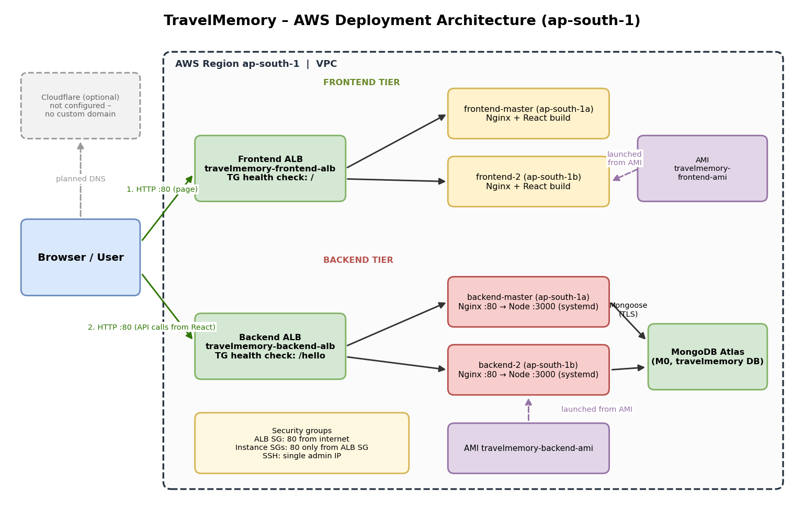

# TravelMemory – MERN Deployment on AWS EC2

Deployment of the [TravelMemory](https://github.com/UnpredictablePrashant/TravelMemory) MERN app on AWS (region `ap-south-1`): Node/Express backend and React frontend, each on two EC2 instances behind its own Application Load Balancer, MongoDB Atlas as the database, Nginx on every instance.

**Live URL (frontend ALB):** `http://travelmemory-frontend-alb-331880389.ap-south-1.elb.amazonaws.com`
**Backend API (ALB):** `http://travelmemory-backend-alb-898376603.ap-south-1.elb.amazonaws.com`

  <!-- export architecture.drawio from draw.io as PNG -->

## 1. Architecture
```
Browser ──► Frontend ALB ──► frontend-master (AZ-a) ┐ Nginx serves React build
                         └─► frontend-2      (AZ-b) ┘
Browser ──► Backend ALB  ──► backend-master  (AZ-a) ┐ Nginx :80 → Node :3000 (systemd)
(React calls the API)    └─► backend-2       (AZ-b) ┘            │
                                                                 ▼
                                                        MongoDB Atlas (M0)
```
| Item | Detail |
|---|---|
| Instances | 4 × `t3.micro`, Ubuntu 22.04, Node 18 |
| Scaling | AMI per tier (`travelmemory-backend-ami`, `travelmemory-frontend-ami`), second node launched from each |
| Load balancing | `travelmemory-backend-alb` (health `/hello`), `travelmemory-frontend-alb` (health `/`) |
| Process manager | systemd (`Restart=always`, enabled on boot, so AMI clones start by themselves) |
| Config | Backend `.env` (`MONGO_URI`, `PORT=3000`); frontend `src/url.js` `baseUrl` = backend ALB |

## 2. Security
- Security-group chaining: instances accept port 80 **only from the ALB security group**; ALB accepts 80 from the internet.
- Port 3000 is never exposed; Nginx is the only entry point.
- SSH restricted to one admin IP, temporary test rules removed after validation (direct `curl` to an instance times out; via ALB returns `Hello World!`).
- DB credentials live only in `.env` (mode 600, not committed); Atlas user has a strong password.
- Known trade-off: Atlas allows `0.0.0.0/0` (instance IPs are dynamic). In production use a NAT gateway/Elastic IPs or VPC peering/PrivateLink.

## 3. How it was deployed
Everything is scripted in [`deploy.sh`](deploy.sh) (AWS CLI, resumable via `state.env`).
```bash
export VPC_ID=<vpc-id> KEY_NAME=<keypair> AWS_DEFAULT_REGION=ap-south-1
export MONGO_URI='mongodb+srv://<user>:<pass>@cluster0.xxxxx.mongodb.net/travelmemory?retryWrites=true&w=majority'
./deploy.sh backend    # SGs → backend-master → verify → AMI → backend-2 → backend TG + ALB
./deploy.sh frontend   # frontend-master (baseUrl = backend ALB) → verify → AMI → frontend-2 → frontend TG + ALB
./deploy.sh cleanup    # tear everything down
```
Order note: the backend ALB is created **before** the frontend is built, so the frontend is built once with the final API address (no rebuild after imaging).

### Backend (per instance, via user-data)
Node 18 from NodeSource, `git clone`, `npm install`, `.env`, systemd unit, Nginx proxy `location / { proxy_pass http://localhost:3000; ... }`.
📸 `03-backend-ec2.png`, `04-backend-systemd-status.png`, `05-backend-hello-curl.png`

### Frontend (per instance, via user-data)
2 GB swap (t3.micro would otherwise run out of memory), `src/url.js` → `export const baseUrl = "http://<backend-alb-dns>"`, `npm run build`, copy to `/var/www/html`, Nginx with `try_files $uri /index.html` for React Router.
📸 `06-frontend-ec2.png`, `07-frontend-browser.png`

### Scaling and load balancing
AMIs created from the verified masters; `backend-2` / `frontend-2` launched from them in a second AZ with no manual steps; target groups register both nodes, ALBs forward port 80.
📸 `09-amis.png`, `10-four-instances.png`, `11-backend-tg-healthy.png`, `12-frontend-tg-healthy.png`, `13-albs.png`

## 4. Validation
```bash
curl http://<backend-alb>/hello                    # Hello World!
for i in 1 2 3 4; do curl -s -o /dev/null -w '%{http_code}\n' http://<alb>/; done   # 200 ×4
curl http://<backend-alb>/trip                     # JSON list from Atlas
```
Add an experience in the UI → appears in the list after refresh (frontend → backend ALB → Atlas).
📸 `16-live-site.png`, `17-add-trip.png`, `18-atlas-documents.png`

## 5. Issues met and how they were solved
| Issue | Cause | Fix |
|---|---|---|
| Health check hung from my machine | Security group allowed a different public IP | Allowed the actual egress IP; later removed |
| `VcpuLimitExceeded` launching `frontend-2` | Account limit 8 vCPUs; another instance was using 2 | Stopped the unrelated instance (quota increase not available) |
| Saving a trip returned `SOMETHING WENT WRONG` (HTTP 200) | App swallows errors; schema requires `shortDescription` and lowercase `tripType` (`backpacking`, `leisure`, `business`) | Added error logging to the controller; filled required fields |

> Note: the app returns HTTP 200 even on save failure, so check the response body, not just the status code.

## 6. Custom domain (Cloudflare)
Not completed: no domain was available. Planned records, once a domain is added to Cloudflare:

| Type | Name | Target |
|---|---|---|
| CNAME | `www` | frontend ALB DNS |
| CNAME | `api` | backend ALB DNS |
| A | `@` (or `direct`) | Elastic IP of `frontend-master` |

Then set Cloudflare SSL mode, set `baseUrl` to `https://api.<domain>` (avoids mixed content) and rebuild the frontend.

## 7. Cost / cleanup
`./deploy.sh cleanup` removes ALBs, target groups, instances, AMIs, snapshots and security groups.
